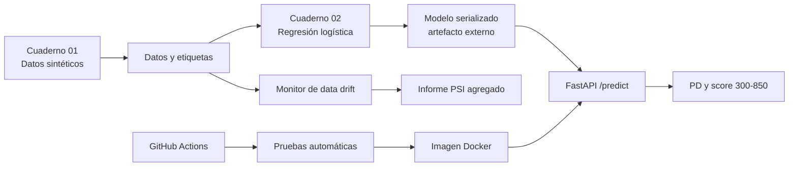

# Bank Risk Scoring · MLOps

Proyecto académico de **scoring de riesgo crediticio** basado en datos bancarios sintéticos, con desarrollo Git-Flow, pruebas CI, API experimental con Docker y monitorización exploratoria de drift.

> **Limitación:** este modelo no reproduce la política de crédito de BBVA y no está validado para decidir sobre solicitudes reales.

## Arquitectura

## Organización

| Ruta | Contenido |
| --- | --- |
| `notebooks/01_generacion_dataset.ipynb` | Simulación de operaciones, solicitudes y etiquetas |
| `notebooks/02_scoring_crediticio.ipynb` | Entrenamiento y evaluación del scoring |
| `src/scoring.py` | Inferencia y transformación de probabilidades |
| `src/api.py` | API FastAPI y validación estricta de 18 variables |
| `src/monitoring.py` | PSI, faltantes, alertas y reportes agregados |
| `docs/monitoring.md` | Guía de monitorización y limitaciones |
| `.github/workflows/drift-ci.yml` | Pruebas y demostración sintética de drift |
| `tests/` | Validaciones del cuaderno y pruebas unitarias de la API |
| `docs/api.md` | Guía de ejecución local y con Docker |
| `.github/workflows/notebook-ci.yml` | Integración continua |

## Flujo de desarrollo

`feature/*` → Pull Request → `develop` → `release/*` → `main`.
Las ramas `hotfix/*` permiten corregir versiones estables. Las integraciones se
documentan en Pull Requests y pasan por CI antes de ser fusionadas.

## Experimento de scoring

- Regresión logística con regularización L2, `C=0.1`, 18 variables.
- Particiones: 119 préstamos de entrenamiento, 44 de validación y 82 de prueba.
- ROC-AUC en prueba: **0,6402**; Average Precision: **0,3369**.
- Brier Score en prueba: **0,1077** frente a 0,1162 de la referencia.
- Prototipo retrospectivo sobre datos sintéticos con resultados sujetos a
  incertidumbre y limitaciones de generalización y disponibilidad temporal.

## API y Docker

El artefacto `.joblib` se guarda **fuera de Git** y se monta localmente.
Sin él, la API devuelve HTTP 503 para las predicciones en lugar de inventar
probabilidades. La imagen Docker se prueba automáticamente en CI.

Consulta [la guía de la API](docs/api.md) para iniciar el servicio y realizar
una consulta con un JSON sintético.

## Monitorización de cambios en las variables

La rama de monitorización compara cohortes de solicitudes a través del PSI,
las tasas de valores faltantes y la aparición de categorías desconocidas.
Los umbrales son **heurísticos**, y GitHub Actions publica una **demostración
sintética**, no alertas sobre clientes ni un sistema de vigilancia operativa.

Para analizar el ZIP generado en Colab se puede ejecutar el monitor localmente:

    python -m src.monitoring --dataset-zip /ruta/dataset_bbva_sintetico_v2.zip --current-partition MONITORIZACION_SIN_ETIQUETA_MADURA

Consulta [la guía de monitorización](docs/monitoring.md) para seleccionar
cohortes, generar informes JSON/Markdown y comprender las limitaciones.

## Advertencia

El sistema no proporciona autenticación, TLS, monitorización conectada
a datos de producción ni validación regulatoria. El PSI no demuestra
degradación de ROC-AUC o Brier Score, y no desencadena reentrenamientos.
No debe exponerse a Internet ni utilizarse con datos reales o para
aprobar/rechazar créditos.

## Versiones y publicación

La versión actual del proyecto es **v1.0.0 (pre-release académica)**. El
código se prepara en `release/1.0.0`, se revisa por Pull Request y únicamente
se integra en `main` después de las pruebas. El workflow
`.github/workflows/release.yml` vuelve a comprobar tests y Docker en `main`
y, si todo pasa y GitHub permite escribir etiquetas, publica `v1.0.0` como
**pre-release experimental**. Los cambios se reintegran después a `develop`.

- [Notas de v1.0.0](docs/releases/v1.0.0.md)
- [Historial de cambios](CHANGELOG.md)

Publicar una versión del repositorio **no** valida clínicamente, financiera ni
regulatoriamente el modelo ni supone despliegue a producción.
