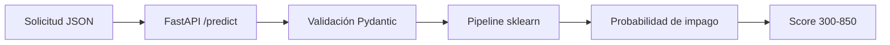

# API experimental de scoring crediticio

Este servicio ofrece inferencia del **modelo de 18 variables** desarrollado en
`notebooks/02_scoring_crediticio.ipynb`. La aplicación utiliza FastAPI y no
reentrena ni modifica el modelo. No contiene clientes reales ni credenciales.

> Es un prototipo académico entrenado sobre datos sintéticos, no apto para
> conceder o rechazar créditos reales. En TEST el ROC-AUC fue 0,6402 y persisten
> limitaciones de calibración, sesgo de selección y evaluación retrospectiva.

## Arquitectura



## Modelo requerido

Desde el cuaderno, guardar **`modelo_final`**, no `modelo_scoring`:

```python
import joblib
joblib.dump(modelo_final, "modelo_scoring_crediticio_v1.joblib")
```

Colocar el archivo obtenido en `models/modelo_scoring_crediticio_v1.joblib`.
No subirlo al repositorio: los archivos `.joblib` están ignorados por Git.

**Seguridad:** `joblib.load` puede ejecutar código al deserializar. Cargar
exclusivamente artefactos propios cuya procedencia y hash se conozcan. Antes
de iniciar la API, comprobar que la versión de `scikit-learn` y las demás
dependencias sean compatibles con el entorno donde Colab guardó el archivo.
El cuaderno exporta la versión de `scikit-learn` en
`metadatos_modelo_v1.json`. Los números fijados en `requirements.txt`
corresponden al entorno API y **no garantizan** compatibilidad con un modelo
guardado en otra versión. Si no coinciden, ajustar las dependencias y
reconstruir el contenedor.

La API comprueba que el modelo tenga las 18 columnas esperadas en el orden
correcto y que sus clases sean `0` y `1`.

## Ejecutar localmente

```bash
python -m venv .venv
source .venv/bin/activate
pip install -r requirements.txt
uvicorn src.api:app --host 127.0.0.1 --port 8000
```

En Windows, activar el entorno con `.venv\\Scripts\\activate`.
La documentación interactiva aparece en `http://127.0.0.1:8000/docs`.

## Ejecutar con Docker

```bash
docker build -t bank-risk-scoring:dev .
docker run --rm -p 127.0.0.1:8000:8000 \
  -v "$(pwd)/models:/app/models:ro" bank-risk-scoring:dev
```

Adaptar la ruta de montaje al sistema operativo. El Dockerfile **no incluye**
el modelo entrenado: se proporciona externamente como volumen de solo
lectura.

## Salud y disponibilidad

- `GET /health/live`: el proceso HTTP responde (200), incluso sin modelo.
- `GET /health/ready`: devuelve 200 solo cuando el modelo está cargado;
  devuelve **503** si está ausente o es incompatible.
- `POST /predict`: espera exactamente las 18 variables financieras;
  devuelve probabilidad, score de 300 a 850 y versión experimental.
  Si no hay modelo devuelve **503**, jamás predicciones inventadas.
- `GET /docs`: documentación Swagger autogenerada.

**Ejemplo (archivo sintético para probar la interfaz):**

```bash
curl -X POST http://127.0.0.1:8000/predict \
  -H "Content-Type: application/json" \
  --data-binary @examples/solicitud_sintetica.json
```

La solicitud de ejemplo pertenece a la estructura del dataset sintético y
no representa una persona real. No transmitir datos de clientes reales a
esta API de demostración. El servicio no registra cuerpos de solicitud ni
devuelve información personal. No incluye autenticación, limitación de
peticiones, cifrado TLS o auditoría regulatoria; no exponerlo a Internet.

## Ejecutar las pruebas

```bash
pip install -r requirements-test.txt
python -m unittest discover -s tests -p "test_*.py" -v
```

Las pruebas del servicio utilizan un **doble de prueba determinista**,
únicamente para comprobar la interfaz y las reglas de validación. No
simulan el rendimiento de un modelo entrenado. Las verificaciones estáticas
de los cuadernos no reemplazan un entrenamiento reproducible ni una
validación independiente de riesgo crediticio.
